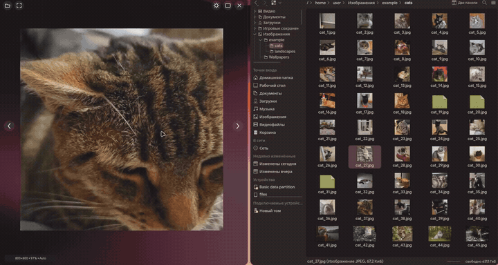

# Viewlume

[](https://github.com/vaniley/viewlume/actions/workflows/ci.yml)
[](LICENSE)

[Русская версия](README.ru.md)

Viewlume is a fast, GPU-accelerated image viewer for Linux and Windows. It keeps the image in focus with a transparent fullscreen mode, fluid zoom and pan, keyboard navigation, and a lightweight thumbnail carousel.

## Demo



## Highlights

- GPU rendering through `egui`, `eframe`, and `wgpu`.
- Background decoding, bounded thumbnail work, adjacent-image prefetching, and RAM caches.
- Visual size and on-screen position preserved when switching between different resolutions.
- Cursor-centered zoom and short, configurable pan inertia.
- Frameless fullscreen overlay with auto-hiding controls.
- Scrollable cover-flow carousel with virtualized thumbnails.
- Natural filename sorting and EXIF orientation support.
- Configurable transitions, filtering, cache limits, navigation, and carousel behavior.

## Supported formats

JPEG/JFIF, PNG, animated WebP and GIF, BMP, TIFF, QOI, ICO, TGA, DDS,
OpenEXR, Radiance HDR, Farbfeld, and PNM (PBM/PGM/PPM/PAM).

## Install

Download the archive for your platform from [GitHub Releases](https://github.com/vaniley/viewlume/releases).

### Linux

```console
# Download and verify
wget https://github.com/vaniley/viewlume/releases/latest/download/viewlume-linux-x86_64.tar.gz
wget https://github.com/vaniley/viewlume/releases/latest/download/viewlume-linux-x86_64.sha256
sha256sum -c viewlume-linux-x86_64.sha256

# Extract and install
tar xzf viewlume-linux-x86_64.tar.gz
sudo cp viewlume/viewlume /usr/local/bin/
```

The release also provides a portable AppImage and a DEB package.

Runtime dependencies (Wayland/X11 libs and GTK for file dialogs):

```console
# Ubuntu / Debian
sudo apt install libwayland-client0 libxkbcommon0 libgtk-3-0

# Fedora
sudo dnf install wayland-devel libxkbcommon gtk3

# Arch / CachyOS / Manjaro — already included in a standard desktop install
```

### Windows

1. Download the MSI installer or `viewlume-windows-x86_64.zip` from [Releases](https://github.com/vaniley/viewlume/releases).
2. Extract the ZIP to any folder (e.g. `C:\Program Files\Viewlume\`).
3. Run `viewlume.exe`. No extra dependencies required.
4. Optionally add the folder to `PATH` (Settings > System > Advanced > Environment Variables > Path).

#### Opaque-window compatibility launch

Viewlume normally creates a transparent-capable native window for its overlay mode. If a Windows
compositor or driver has trouble starting that window, launch one process with an opaque native
window instead:

```console
# Command Prompt
set VIEWLUME_OPAQUE_WINDOW=1
viewlume.exe

# PowerShell
$env:VIEWLUME_OPAQUE_WINDOW = "1"
.\viewlume.exe
```

This is a process-only override: it does not change saved settings. GPU rendering, backend
selection, and synchronized presentation remain enabled, but the desktop cannot show through the
window. It may help transparency/compositor compatibility; it cannot repair an unavailable GPU
adapter or an unsupported driver.

### Usage

```console
viewlume path/to/image.png
viewlume path/to/folder
```

## Controls

| Input | Action |
| --- | --- |
| `←` / `A`, `→` / `D` | Previous or next image |
| `Home`, `End` | First or last image in the folder |
| Mouse wheel | Zoom toward the pointer |
| Mouse wheel over carousel | Scroll thumbnails horizontally |
| Drag with left, middle, or right mouse button | Pan image |
| Double click | Configured fullscreen/fit action |
| `F` / `0` | Fit image to viewport |
| `1` | Actual size (100%) |
| `F11` | Toggle fullscreen overlay |
| `T` | Cycle carousel visibility |
| `N` | Cycle texture filtering |
| `I` | Toggle image information |
| `O` | Open an image |
| `S` | Open settings |
| `Space` | Pause or resume an animated GIF/WebP |
| `Esc` | Close settings or leave fullscreen |

Files can also be opened with drag and drop.

## Build from source

Install the stable Rust toolchain, then run:

```console
cargo build --release --locked
```

The executable is written to `target/release/viewlume` on Linux or `target/release/viewlume.exe` on Windows.

Linux builds may require the Wayland/X11 and GTK development packages supplied by the distribution. On Ubuntu:

```console
sudo apt-get install libwayland-dev libxkbcommon-dev libgtk-3-dev libatk1.0-dev libglib2.0-dev
```

## Configuration

Viewlume stores settings in the platform configuration directory:

- Linux: `~/.config/viewlume/config.toml`
- Windows: `%APPDATA%\vaniley\viewlume\config\config.toml`

An existing configuration from the former `image-viewer` name is migrated automatically on first launch.
The interface supports English and Russian; English is used by default.

When renderer startup succeeds or fails, Viewlume writes a best-effort diagnostic log beside this
file as `diagnostics.log` (with one rotated `diagnostics.log.1` file). Each file is limited to
256 KiB. The log records app/OS versions, requested and selected renderer backends, adapter and
effective device-limit details, the native transparency policy, and startup errors. It never logs
image paths or image contents; an inability to write the log does not prevent startup.

## Contributing

See [CONTRIBUTING.md](CONTRIBUTING.md). Security reports should follow [SECURITY.md](SECURITY.md).

## License

Viewlume is available under the [MIT License](LICENSE).
